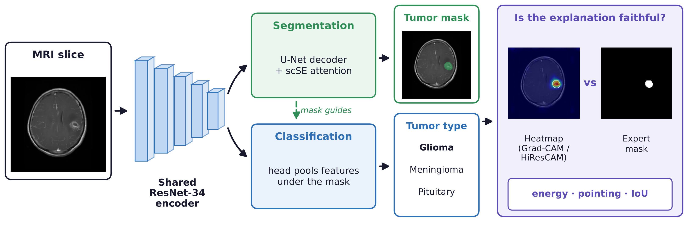
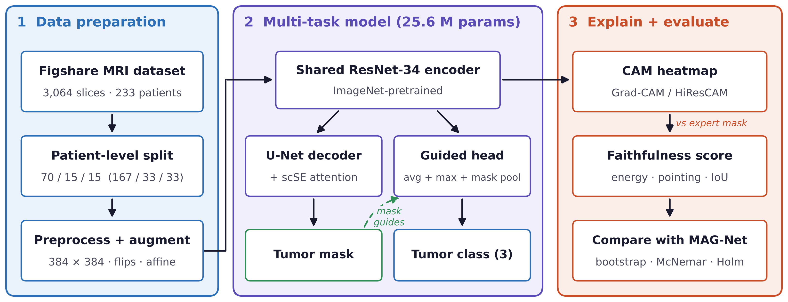

# Deep Learning Model for Brain Tumor Segmentation and Classification using Grad-CAM Faithfulness Scoring

BCSE497J Project-I, VIT Vellore (SCOPE): Aman Hooda (23BDS0157), Himank (23BCE0039), K. Hutesh (23BCE0019).
Guide: Prof. Sivaraj C.

One network segments the tumour and classifies it (glioma / meningioma / pituitary) from a single
T1-weighted contrast-enhanced MRI slice. Its explanation heatmaps (Grad-CAM and HiResCAM) are scored
with numbers against the expert tumour masks. Everything is evaluated on a **frozen patient-level
split** and compared slice by slice with the MAG-Net base paper (Gupta et al., BDA 2021) on the same
test patients.



## Results at a glance

Figshare brain tumour dataset (Cheng et al.): 3,064 slices, 233 patients, split 167 / 33 / 33 patients.
Test set: 469 slices from 33 unseen patients.

| Run (setting chosen on validation) | Accuracy | Macro-F1 | Dice | Gain over MAG-Net [95% CI] | McNemar (only ours right / only MAG-Net right) |
|---|---|---|---|---|---|
| Run 1 (3-model ensemble + flip) | 98.72% | 98.63% | 0.8395 | +3.84 pts [+0.80, +7.73] | 22 / 4, p < 0.001 |
| Run 2 (seed 0 + flip) | 98.08% | 97.95% | 0.8305 | +3.20 pts [+0.25, +6.61] | 21 / 6, p = 0.006 |
| Run 3 (seed 0 + flip) | 97.87% | 97.73% | 0.8296 | +2.99 pts [+0.18, +6.50] | 20 / 6, p = 0.009 |
| **Mean ± SD** | **98.22 ± 0.44%** | 98.10 ± 0.47% | **0.833 ± 0.006** | | |
| Ablation: no mask-guided pooling (seed 1 + flip) | 98.29% | 98.17% | 0.835 | +3.41 pts [+0.58, +6.99] | 21 / 5, p = 0.002 |
| MAG-Net (our re-implementation, same split) | 94.88% | 94.67% | 0.760 | – | – |

Explanation faithfulness on the same model (encoder stage 1/16, runs 2 / 3):

| Method | Energy inside tumour | Pointing game | IoU@0.5 |
|---|---|---|---|
| Grad-CAM | 0.024 / 0.042 | 16.4% / 32.0% | 0.045 / 0.120 |
| HiResCAM (chosen on validation) | 0.180 / 0.207 | 62.7% / 77.0% | 0.188 / 0.245 |
| Uniform heatmap (chance) | 0.016 | – | – |

Main findings:

- The model beats MAG-Net on the same unseen patients in all three runs.
- The ablation shows the gain comes from the pretrained encoder, the scSE decoder and the training
  recipe, not from the mask-guided pooling.
- HiResCAM puts 18–21% of its heatmap on the tumour against 2–4% for Grad-CAM, with or without the
  mask-guided pooling: the choice of explanation method changes how trustworthy a model looks.

All numbers come from the Kaggle logs in [`logs/`](logs/); [`logs/README.md`](logs/README.md) maps
every table entry to its file and line.



## 1. What the model is

```
input slice (1 x 384 x 384)
   │
ImageNet-pretrained ResNet-34 encoder  (shared by both tasks)
   │  features at 1/2, 1/4, 1/8, 1/16 (F4), 1/32 (F5)
   ├──► U-Net decoder with scSE attention ──► tumour mask
   └──► segmentation-guided classification head
          F5: average pool, max pool, mask-attention pool
          F4: average pool, mask-attention pool
          mask-attention pool = Σ F·p / Σ p, with p = predicted tumour probability (detached)
          → Linear-BN-ReLU-Dropout-Linear ──► 3 class scores
```

The mask-attention pool is the part that makes the two tasks help each other: the segmentation
branch tells the classifier which region to read. The probability map is detached, so the
classification loss cannot bend the mask to suit itself.

**Training:** BCE + soft-Dice for the mask, class-weighted cross-entropy with label smoothing 0.1
for the class; AdamW (encoder 1e-4, rest 3e-4), 3-epoch warm-up then cosine decay, mixed
precision, gradient clipping, EMA of the weights, early stopping on the **validation** score
(0.5 · Dice + 0.5 · macro-F1). Augmentation: flip, affine (scale, shift, rotate), brightness /
contrast, gamma, noise / blur.

**Inference:** single model or a 3-seed ensemble, with or without flip test-time augmentation.
`evaluate.py` scores all of these and **chooses the one to report on the validation split**.

## 2. What changed from the previous version (v5)

| | v5 multi-task | v6 (this project) |
|---|---|---|
| Encoder | U-Net encoder trained from scratch | ResNet-34 pretrained on ImageNet |
| Decoder | plain U-Net | U-Net + scSE channel/spatial attention |
| Classification head | global average pool of bottleneck | multi-scale avg + max + **segmentation-guided attention pool** |
| Input size | 256 | 384 |
| Optimiser | Adam | AdamW, warm-up + cosine, AMP, grad clipping, EMA |
| Classification loss | class-weighted CE | + label smoothing |
| Inference | single model | val-selected among single / TTA / 3-seed ensemble |
| Statistics | slice bootstrap | slice **and patient-cluster** bootstrap, McNemar, Holm |
| Parameters | 31.31M | 25.6M per model |

## 3. Files

| Path | Purpose |
|---|---|
| `btmtl/data.py` | dataset discovery, frozen split loading with leakage check, RAM cache, augmentation |
| `btmtl/model.py` | `ProposedMTNet` |
| `btmtl/losses.py` | segmentation + classification loss (fixed or uncertainty weighting) |
| `btmtl/metrics.py` | Dice/IoU, accuracy/F1, slice and patient-cluster bootstrap, McNemar, Holm |
| `btmtl/gradcam.py` | batched Grad-CAM and faithfulness scores |
| `train.py` | trains one seed |
| `evaluate.py` | val + test evaluation, configuration selection on val, Grad-CAM, figures |
| `explain.py` | Grad-CAM vs HiResCAM at two encoder stages, chosen on val; no retraining |
| `compare.py` | paired test vs MAG-Net and vs the previous multi-task model |
| `demo/` | live web app for the presentation (see demo/README.md) |
| `deploy/` | put the web app online: Render free plan (deploy/DEPLOY_RENDER.md) or Hugging Face (deploy/DEPLOY.md) |
| `run_all.sh` | 3 seeds → evaluate → compare → zip (uses both GPUs if present) |
| `splits/patient_split.json` | frozen split: 167 / 33 / 33 patients, 2186 / 409 / 469 slices |
| `baselines/` | per-slice test results of MAG-Net and the v5 multi-task model on that split |
| `scripts/prepare_data.py` | .mat → images/masks/labels.csv (only if you do not have `bt-data`) |
| `notebooks/kaggle_run.ipynb` | the Kaggle notebook |
| `KAGGLE_STEPS.md` | step-by-step run guide |

## 4. Run

See **KAGGLE_STEPS.md**. In short:

```bash
pip install -q segmentation-models-pytorch==0.5.0 albumentations==2.0.8
bash run_all.sh            # finds the data under /kaggle/input automatically
```

Outputs: `results/eval.json`, `results/eval_per_slice.csv`, `results/figures/`,
`results/comparison/comparison.md`, `runs/seed*/best.pth`.

## 5. Base-paper comparison

| Model (same patient split, 469 test slices / 33 patients) | Dice | Accuracy | Macro-F1 |
|---|---|---|---|
| MAG-Net (base paper, our re-implementation) | 0.760 | 94.88% | 94.67% |
| Previous multi-task (v5) | 0.768 | 94.88% | 94.66% |
| **Proposed v6** (mean of 3 runs) | 0.833 ± 0.006 | 98.22 ± 0.44% | 98.10 ± 0.47% |

MAG-Net's **published** 98.04% was measured on a split that is not described as patient-level, so
slices of one patient may sit in both training and test. That can inflate accuracy and is not
comparable with a patient-level split. The fair comparison is the row above, on identical test slices, and
`compare.py` tests whether any difference is larger than chance.

## 6. Rules that keep the result honest

- The split file is never changed. `train.py` and `evaluate.py` stop if the slice counts differ.
- Training never sees the test split; the configuration is picked on validation.
- Train the three seeds once. Re-running until the test number crosses a target turns the test
  set into a validation set.
- With 469 test slices from 33 patients, the 95% interval on accuracy is roughly ±2 points; use
  the patient-cluster intervals and `compare.py` p-values when you claim an improvement.
- Explanation method: `explain.py` chooses between Grad-CAM and HiResCAM (and the encoder stage)
  on the validation split by CAM energy inside the tumour, decided before looking at test.
  Baselines were explained with Grad-CAM, so CAM differences against them mix model and method;
  the within-v6 Grad-CAM vs HiResCAM comparison is the clean one.
- Design check: because the head pools features under the predicted mask, more heatmap energy
  inside the tumour could be partly built into the design. The ablation (`train.py --no_seg_guided`)
  removes that pooling; HiResCAM still puts 0.211 of its energy on the tumour vs 0.031 for
  Grad-CAM, so the explanation finding does not depend on it.

## 7. Repository layout additions

| Path | Purpose |
|---|---|
| `logs/` | unedited Kaggle logs for runs 1–3 and the ablation, with a README mapping every reported number to its file and line |
| `docs/figures/` | architecture, overview, training curves, Grad-CAM vs HiResCAM, ablation and example heatmaps |

Model checkpoints (`best.pth`, about 100 MB per seed) and the dataset are not stored in the
repository. The dataset is public: Cheng, J. "Brain tumor dataset", figshare, 2017.

## 8. Paper

A 6-page paper describing this work has been submitted to ICDSI 2027 (Intelligent Systems track)
and is under review.
